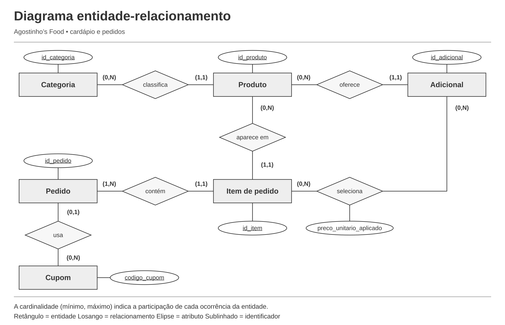

# Modelagem do banco de dados

Agostinho’s Food — cardápio, personalização e pedidos de delivery.

O modelo descreve o cardápio e os pedidos prontos para encaminhamento ao WhatsApp. O carrinho em montagem pode estar vazio. Para registrar um pedido, é preciso ter ao menos um item, o nome do cliente e o endereço de entrega.

## DER

A cardinalidade `(mínimo, máximo)` junto de uma entidade indica quantas vezes cada ocorrência dela pode participar do relacionamento. `N` representa muitos.

| Entidade | O que representa |
| --- | --- |
| Categoria | Um grupo do cardápio, como Pizzas ou Bebidas. |
| Produto | Um item oferecido no cardápio, com descrição, imagem e preço. |
| Adicional | Uma opção de personalização oferecida para um produto, com nome e preço. |
| Pedido | Os dados de entrega, pagamento e desconto de um pedido pronto para encaminhamento. |
| Item de pedido | Uma linha do pedido, com produto, quantidade, preço e observação. |
| Cupom | Um código promocional com um percentual de desconto. |

| Relacionamento | Para cada ocorrência da primeira entidade | Para cada ocorrência da segunda entidade |
| --- | --- | --- |
| Categoria classifica Produto | Uma categoria classifica de zero a muitos produtos. | Um produto pertence a exatamente uma categoria. |
| Produto oferece Adicional | Um produto oferece de zero a muitos adicionais. | Um adicional pertence a exatamente um produto. |
| Pedido contém Item de pedido | Um pedido contém de um a muitos itens. | Um item pertence a exatamente um pedido. |
| Produto aparece em Item de pedido | Um produto pode aparecer em zero a muitos itens. | Um item se refere a exatamente um produto. |
| Item de pedido seleciona Adicional | Um item pode selecionar de zero a muitos adicionais. | Um adicional pode ser selecionado em zero a muitos itens. |
| Pedido usa Cupom | Um pedido usa zero ou um cupom. | Um cupom pode ser usado em zero a muitos pedidos. |

A relação entre pedido e produto é N:M e fica representada pelo **Item de pedido**. A seleção de adicionais também é N:M e tem um atributo próprio, o preço do adicional aplicado naquele item.

## Modelo lógico

**PK** identifica a chave primária. **FK** identifica uma chave estrangeira e indica a coluna que ela referencia. A chave composta de `itens_adicionais` reúne duas colunas e impede a repetição do mesmo adicional no mesmo item.

| Tabela | PK | FKs | Demais colunas |
| --- | --- | --- | --- |
| `categorias` | `id_categoria` | — | `nome` |
| `produtos` | `id_produto` | `id_categoria` → `categorias.id_categoria` | `nome`, `descricao`, `imagem_url`, `preco_atual`, `nota_exibida`, `selo` (opcional) |
| `adicionais` | `id_adicional` | `id_produto` → `produtos.id_produto` | `nome`, `preco_atual` |
| `cupons` | `codigo_cupom` | — | `percentual_desconto` |
| `pedidos` | `id_pedido` | `codigo_cupom` → `cupons.codigo_cupom` (opcional) | `data_pedido`, `nome_cliente`, `endereco_entrega`, `forma_pagamento`, `troco_para` (opcional), `valor_frete`, `valor_desconto` |
| `itens_pedido` | `id_item` | `id_pedido` → `pedidos.id_pedido` e `id_produto` → `produtos.id_produto` | `quantidade`, `observacao` (opcional), `preco_unitario_produto` |
| `itens_adicionais` | `(id_item, id_adicional)` | `id_item` → `itens_pedido.id_item` e `id_adicional` → `adicionais.id_adicional` | `preco_unitario_aplicado` |

### Regras de registro

- O site pede nome e endereço a cada compra. Esses dados pertencem ao pedido. A forma de pagamento é Pix, cartão na entrega ou dinheiro. O valor para troco é opcional e se aplica ao pagamento em dinheiro.
- O item tem quantidade maior que zero. O mesmo produto pode aparecer em linhas diferentes de um pedido, por exemplo, quando tem adicionais ou observações diferentes.
- As chaves estrangeiras identificam os registros relacionados. Ao registrar o pedido, deve-se verificar que ele tem pelo menos um item e que cada adicional selecionado é oferecido pelo produto daquele item.
- Os preços unitários aplicados ficam nos itens e nas seleções de adicionais. Assim, alterações posteriores no cardápio preservam o valor do pedido já registrado. O valor do frete e o valor do desconto também ficam no pedido. Quando não há cupom, o desconto é zero.
- O subtotal é a soma dos itens. Para cada item, some o preço unitário do produto aos preços unitários dos adicionais e multiplique pela quantidade. O total é o subtotal mais o frete, menos o desconto.

## Modelo físico no MySQL

O [banco.sql](../database/banco.sql) cria as sete tabelas com chaves e restrições e carrega o cardápio e os cupons. Valores monetários usam `DECIMAL(10,2)`. O percentual do cupom fica na escala de 0 a 100, como `10.00` para 10%.

Ao gravar um pedido, o PHP verifica se há pelo menos um item, se os adicionais pertencem ao produto e se os preços e o total conferem. A coluna técnica `chave_requisicao` é única para identificar o reenvio de um pedido que já foi registrado.

O [README](../README.md#consultas-de-exemplo) reúne exemplos de junções e agrupamento das apostilas.

## Referências de aula

- **Banco de Dados — Modelagem Conceitual (ER)**, módulos 1, 3 e 5, para notação do DER, cardinalidades e passagem para o modelo lógico.
- **Banco de Dados & SQL — 2º bimestre**, capítulos 3 a 7 e 9, para chaves, normalização e relacionamentos.
- **Banco de Dados — 4º bimestre**, capítulos 1 e 5, para o exemplo de `loja_virtual` e a relação entre pedidos, itens e produtos.
