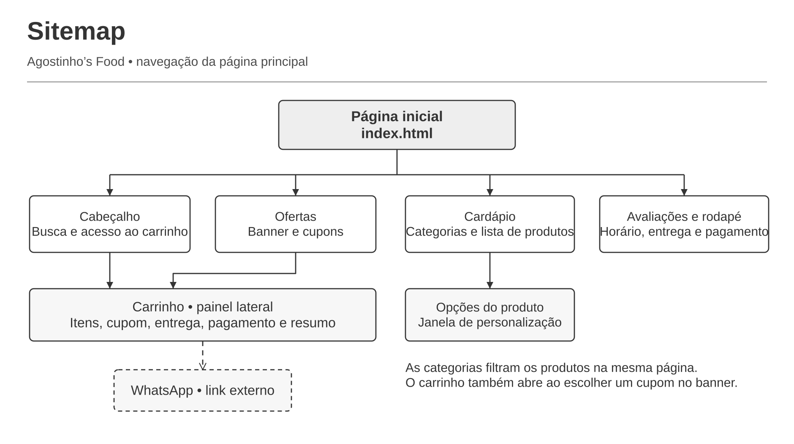
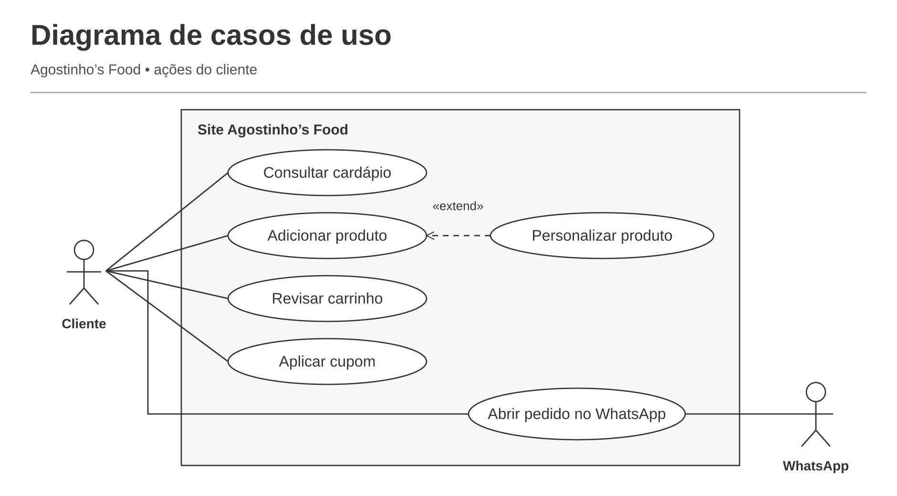
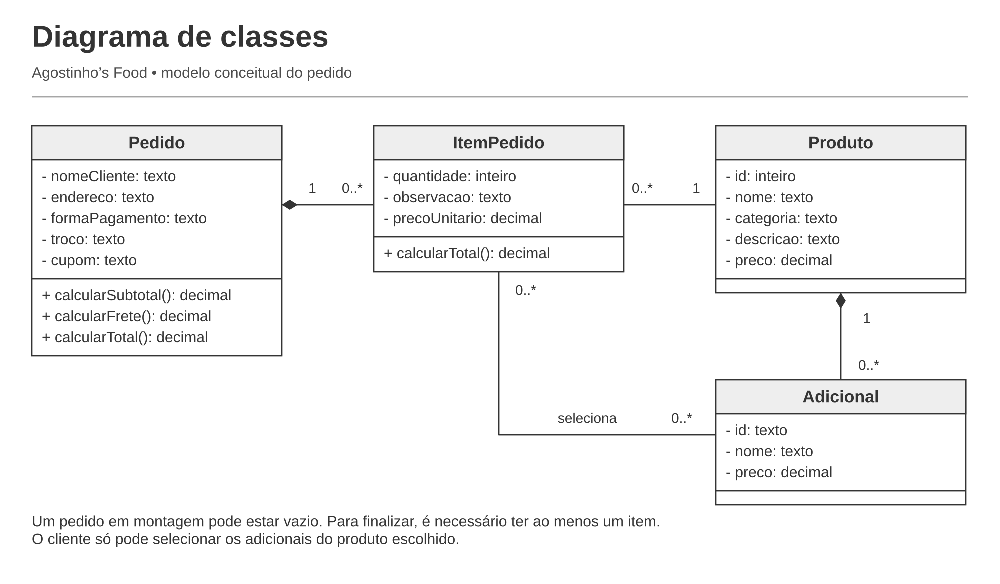
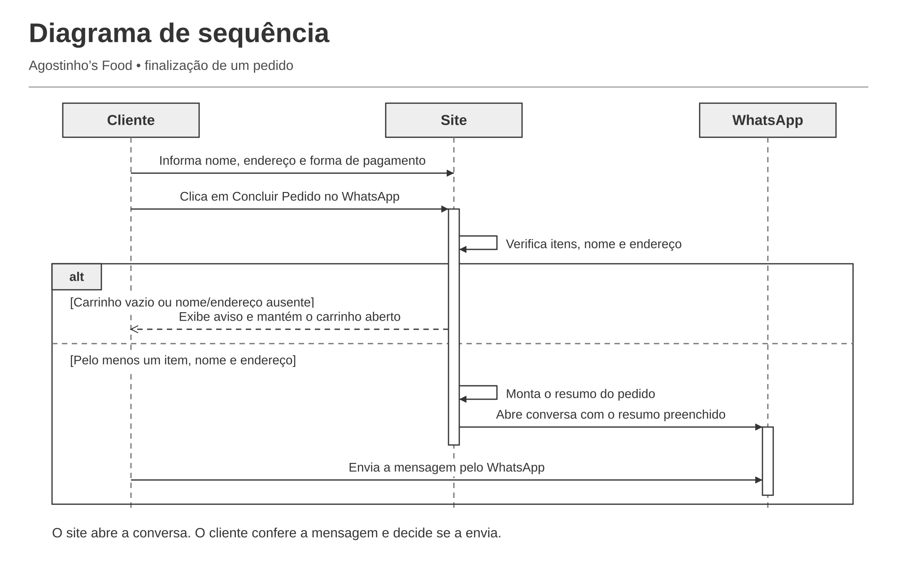
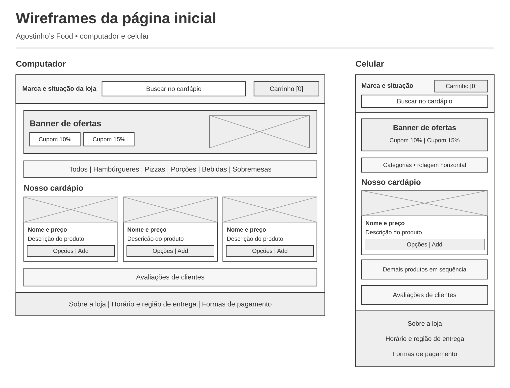
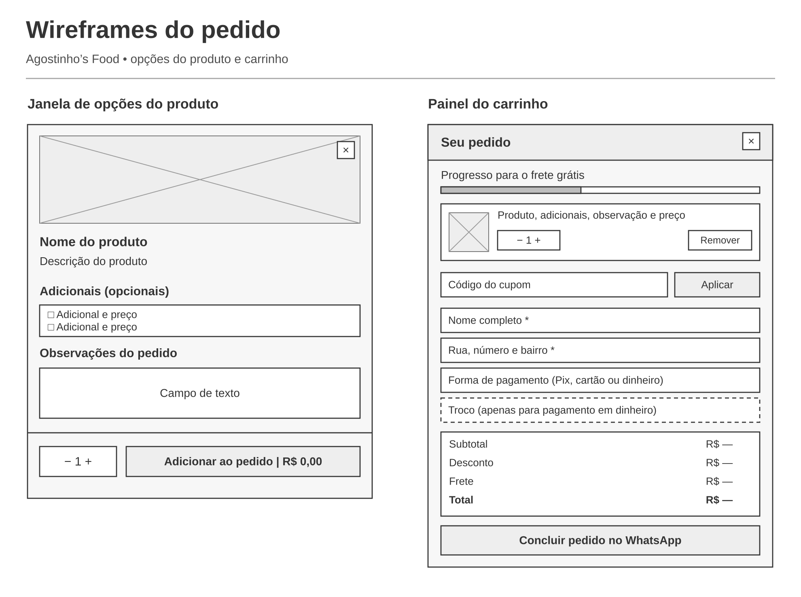

# Planejamento do Agostinho’s Food

O site permite consultar o cardápio, montar um pedido de delivery e preparar uma mensagem para o restaurante. Seu usuário é o cliente que faz o pedido pelo celular ou computador.

## Requisitos

| Código | Requisito |
| --- | --- |
| RF01 | Exibir o cardápio e permitir que o cliente busque por nome ou descrição e filtre por categoria. |
| RF02 | Permitir adicionar o produto diretamente ou, quando houver a opção, escolher adicionais, quantidade e observação. |
| RF03 | Exibir o carrinho e permitir alterar quantidades, remover itens, aplicar cupom e consultar subtotal, desconto, frete e total. |
| RF04 | Solicitar nome e endereço, permitir selecionar a forma de pagamento e exibir o campo de troco ao selecionar dinheiro. |
| RF05 | Verificar se há itens, nome e endereço antes de abrir o WhatsApp com o resumo do pedido. |
| RNF01 | Adaptar a interface a telas de computador e celular. |

## Sitemap

O site tem uma página HTML. A busca e os filtros atualizam o cardápio na própria página. A janela de opções e o carrinho são abertos sobre ela. O WhatsApp é acessado por um link externo durante a finalização.

## Diagramas UML

### Casos de uso

O cliente consulta o cardápio, adiciona produtos e revisa o pedido. A personalização é opcional. O WhatsApp participa na abertura da conversa.

### Classes

Modelo conceitual do cardápio e do pedido. No JavaScript atual, produtos e itens são representados por objetos e listas. O pedido em montagem pode ter zero ou mais itens e cada item se refere a um produto. Um item pode selecionar vários adicionais disponíveis para seu produto.

### Sequência

O cenário começa com o carrinho aberto. Com os dados obrigatórios preenchidos e pelo menos um item, a página monta e abre a mensagem. O envio é feito pelo cliente no WhatsApp.

## Wireframes

Esboços de baixa fidelidade da página inicial no computador e no celular. As caixas de imagem indicam onde ficam as fotos e o banner.

A janela de opções permite personalizar o produto. O carrinho reúne os itens, os dados de entrega, a forma de pagamento e o resumo do pedido. No celular, o painel do carrinho se ajusta à largura disponível.

## Referências de aula

- **DWS — Guia de Organização de Projetos Web**, capítulos 2 e 3, para nomenclatura e caminhos relativos.
- **DWS — Apostila do 3º Bimestre**, semanas 1 e 2, para requisitos, sitemap, wireframes e organização de pastas.
- **POO — Apostila do 3º Bimestre**, capítulos 2 a 4, para casos de uso, classes e sequência.

[Editar os diagramas e wireframes no Draw.io](diagramas.drawio).
